<p align="center">
  
</p>

# KiPI — DC, AC and Coupled Noise Power Integrity Simulator (Standalone or KiCad Plugin)

[](https://github.com/drewsum/KiPI/actions/workflows/ci.yml)
[](LICENSE)
[](#requirements)
[](#requirements)
[](#requirements)

**New to power integrity? Read the [Solver Guide](https://drewsum.github.io/KiPI/solver-guide.html)**
([source](docs/solver-guide.html)): what PI analysis is, why it matters, and how KiPI's mesh
and its DC, thermal, AC and coupled noise solvers work.

KiPI is a power integrity analyzer that runs standalone or as a KiCad 9 and 10 IPC plugin. It has three
analysis modes:

* **DC: Voltage Drop.** Define voltage regulators (VRMs), loads (current into pins) and series
  parts (beads, resistors, load switches), then simulate the voltage drop net by net, across
  every copper layer. Inspect voltage, current density, via currents, copper power
  dissipation and (optionally) board temperature in a rotatable 3D view, with PASS/FAIL
  checks for loads, VRMs, vias and temperature, and write an interactive HTML report or a
  PDF.
* **AC: PDN Impedance.** Give the decoupling capacitors RLC models and put probes on a
  device's power pins, then sweep the impedance of the power distribution network (planes,
  vias, mounting and capacitors) over frequency. Check it against a flat or custom target
  impedance, with a calculator that determines the target from the load's transient spec.
* **Coupled Noise: Switcher Noise on Signal Nets.** Treat a buck or boost regulator as an
  aggressor: KiPI builds its switch node, inductor and capacitor ripple waveforms from the
  layout, then works out the noise they couple onto the signal nets you name (the victims)
  through capacitance, mutual inductance and shared ground. Each victim's receiver is
  checked against its logic family's noise margin, with the line held high and held low, and
  the 3D view shows where along its traces the noise couples in.

New to KiPI? The **[user guide](docs/help.html)** (also the **Help** button in KiPI, or
**F1**) walks through every button, the workflows and what the results mean. Every
control in KiPI has a tooltip.

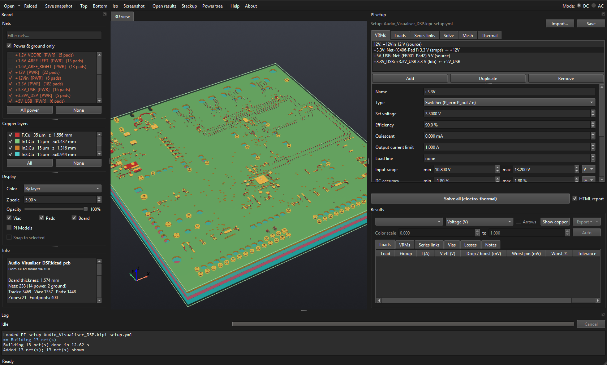

**Status: 0.9.1 (alpha, in development)** ([changelog](docs/CHANGELOG.md)). Added a standalone mode. This tool can now run on its own, has an app launcher that handles dependencies, and can import data from arbitrary layouts. The author wants to add support for a variety of PCB file formats to be able to import. If you have an example with good complexity which uses a wide variety of your PCB design tool's features that you are willing to share, please open an [issue](https://github.com/drewsum/KiPI/issues) and attach your PCB file there. 

## Install

KiPI runs two ways, from the same folder:

* **As a KiCad plugin**, the main way: click the **KiPI** button in the PCB editor and KiPI
  reads the board open there. For this, the KiPI folder **must be in KiCad's plugins
  folder**, and KiCad installs its dependencies.
* **Standalone**: KiPI started on its own, with its launcher, opens board files and needs
  no KiCad. The folder can be **anywhere**; the launcher installs the dependencies on the
  first start. It opens KiCad 7 to 10 board files (`.kicad_pcb`), ODB++ jobs and KiPI
  snapshots (`.kipi.json.gz`). Reading HYP an CCE files is on the way
  ([#45](https://github.com/drewsum/KiPI/issues/45)).

### As a KiCad plugin

#### Requirements

* **KiCad 9.0 or later.** Developed on KiCad 10.0.7 and confirmed on KiCad 9.0.7. The tests
  also check the API of every release from 9.0.0 to 10.0.6. On KiCad 9, KiPI works around
  the requests that release does not have yet, with two limits on the oldest releases:
  * Before 9.0.3, KiCad cannot say which layers a plated pad has copper on, so pads are kept
    on every layer, including inner layers where KiCad removed unconnected pads. KiPI
    warns about this in its log.
  * KiCad 9.0.0 cannot report net classes.
* **Python 3.10 to 3.13**, the one KiCad runs plugins with. KiCad installs KiPI's
  dependencies with pip, and some of them (Triangle, PyAMG) have no prebuilt packages for
  Python 3.14 yet.
  * **Windows:** KiCad's own Python 3.11. Nothing to do.
  * **Linux:** KiCad uses the system Python. Ubuntu 22.04 and 24.04, Debian 13 and Fedora 42
    work. Ubuntu 26.04 and Fedora 43 ship Python 3.14: until those packages exist, pip has
    to compile them, which needs a C/C++ compiler and the Python headers
    (`sudo apt install build-essential python3-dev`).
  * **macOS:** KiCad bundles Python 3.9, which is too old. Install Python 3.12 (for
    example from python.org or Homebrew) and select it as the **Python interpreter** in
    *Preferences → Plugins*.

#### Steps

1. In KiCad, enable **Preferences → Plugins → Enable KiCad API**.
2. Clone, link (or copy) this repo into your KiCad plugins folder, or uncompress the release source zip. The examples use KiCad 10's
   folder: for KiCad 9, put `9.0` in place of `10.0`. On Windows, KiCad uses your
   *Documents* folder, which may be redirected to OneDrive:

   ```powershell
   $plug = "$([Environment]::GetFolderPath('MyDocuments'))\KiCad\10.0\plugins"
   New-Item -ItemType Junction -Path "$plug\KiPI" -Target "<path to this repo>"
   ```

   On macOS the folder is `~/Documents/KiCad/10.0/plugins`, and on Linux
   `~/.local/share/kicad/10.0/plugins`:

   ```sh
   ln -s "<path to this repo>" ~/Documents/KiCad/10.0/plugins/KiPI          # macOS
   ln -s "<path to this repo>" ~/.local/share/kicad/10.0/plugins/KiPI       # Linux
   ```

   Or, without git, download `KiPI-<version>.zip` from the
   [latest release](https://github.com/drewsum/KiPI/releases/latest) and unzip it into the
   plugins folder, which gives `plugins/KiPI`.

3. Restart the PCB editor. KiCad builds the plugin venv in the background; the first time this
   downloads PySide6 and VTK, so give it a few minutes. The **KiPI** toolbar button appears
   once the venv is ready. If it never appears, right-click the action in
   *Preferences → Plugins* and choose *Recreate Plugin Environment*.

### Standalone

1. Install **Python 3.10 to 3.13** if you do not have one (from
   [python.org](https://www.python.org/downloads/), or your package manager). Python 3.14
   will not do yet: two of KiPI's packages have no prebuilt version for it. On Linux, add
   `python3-venv` (Debian, Ubuntu) and, for the setup window, `python3-tk`.
2. Put the KiPI folder anywhere: clone this repo, or unzip `KiPI-<version>.zip` from the
   [latest release](https://github.com/drewsum/KiPI/releases/latest).
3. Start KiPI with its launcher: double-click **`kipi_launcher.pyw`** (Windows), or run

   ```sh
   python kipi_launcher.py                      # or: python kipi_launcher.py <board>.kipi.json.gz
   ```

   After the first start there is a **KiPI** shortcut with KiPI's icon next to it on
   Windows, to start it from then on (and the folder shows the KiPI icon). A Python file
   cannot have an icon of its own, so on Linux and macOS run
   `python3 kipi_launcher.py --create-shortcut` once: it adds KiPI to the applications
   menu (Linux) or makes `~/Applications/KiPI.app` (macOS), with the KiPI icon.

The first start sets up KiPI. The setup window lists every package KiPI will install with
its size, checked with PyPI for your computer (about 254 MB to download and 810 MB on disk
on Windows), and nothing is installed until you click **Install**. On Windows and Linux
x86-64 it also offers [PARDISO](#optional-faster-solves-on-large-boards-windows-and-linux-x86-64),
and mentions the advantages/disadvantages of using this solver. Everything goes into an environment of KiPI's own, outside the KiPI
folder:

| | KiPI's environment |
|---|---|
| Windows | `%LOCALAPPDATA%\KiPI` |
| macOS | `~/Library/Application Support/KiPI` |
| Linux | `~/.local/share/kipi` |

(`KIPI_HOME` puts it elsewhere.) Setting up takes a few minutes. The launcher installs
with [uv](https://docs.astral.sh/uv/), which is much faster, when it can: uv on the PATH,
or uvx or [pipx](https://pipx.pypa.io/) to fetch it. With none of them, or if uv fails, it
uses Python's own venv and pip. Later starts open KiPI straight
away, and the launcher sets up again by itself when a new KiPI needs different packages.
With no window available (no tkinter, or `--console`), setup asks in the terminal instead.

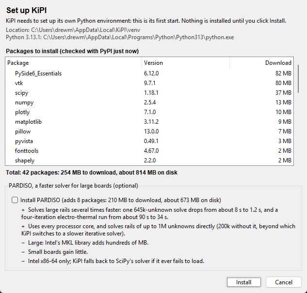

KiPI's window title then ends in *(standalone)*. Use **Open…** to open a board (its arrow
lists the boards opened lately) and **Reload** to read it again; when the board file is
saved, KiPI offers to read it again by itself. KiCad-only controls (*Load from KiCad*,
*Refill zones*, *Select in KiCad*) are hidden; part 3D models are offered when KiCad is
installed.

A `.kicad_pcb` reads the same as the plugin reads it from KiCad: same copper, item ids and
setup file, so a board set up in the plugin opens standalone with its setup, and the other
way round. Net classes come from the `.kicad_pro` beside the board. KiPI uses the zone fills
saved in the file and does not fill zones itself, so **fill the zones in KiCad (B) and save**
before opening the board; zones saved unfilled are listed under *Placeholders* in the board
summary. Files from KiCad 6 or older need saving once in KiCad 7 or later.

An **ODB++** job opens as a `.zip`, `.tgz` or `.tar.gz`, or unpacked (pick its
`matrix/matrix` file). KiPI reads the copper as the job gives it, ties it to nets through
the job's netlist, and takes the stackup from the layer matrix. The setup is found by the
job's name, so export `Board.zip` next to `Board.kicad_pcb` to share the board's setup.
Export at 6 decimals where you can: KiCad's default of 2 rounds every coordinate to
10 µm (copper thickness comes from the copper weight, so it stays right). What the job
does not carry is listed under *Placeholders*; KiCad's export in particular leaves out
the nets of copper drawings, writes a dielectric's sublayers as one, and turns spaces in
net names into underscores.

To change the setup later, use **About → Manage dependencies…** in KiPI, or the launcher:

```sh
python kipi_launcher.py --setup              # the setup window again (add or remove PARDISO)
python kipi_launcher.py --add-pardiso        # or --remove-pardiso, without questions
python kipi_launcher.py --repair             # reinstall everything from scratch
python kipi_launcher.py --reset              # delete KiPI's environment
python kipi_launcher.py --create-shortcut    # add KiPI to the Start menu / app menu / ~/Applications
```

If setup fails, the launcher says why; everything the installer printed is in the `logs`
folder next to the environment.

On Windows, KiPI can be pinned to the taskbar: right-click its taskbar button while it is
open (plugin or standalone), or its Start menu shortcut, and choose *Pin to taskbar*. The
pinned button starts standalone KiPI through the launcher, as KiCad is needed to start the
plugin.

KiPI shows as **KiPI**, with its icon, in Windows Task Manager, macOS Activity Monitor and
Linux System Monitor / top, rather than as Python. On Windows it runs on `KiPI.exe`, a copy
of its environment's Python that it makes in the environment's `Scripts` folder the first
time (with the Python DLLs it needs beside it); if that copy cannot start, KiPI runs on
`pythonw.exe` as before.

### Optional: faster solves on large boards (Windows and Linux, x86-64)

KiPI solves each rail with SciPy's single-threaded sparse solver, or with AMG when a rail
has more than 200k unknowns. If the optional [`pypardiso`](https://pypi.org/project/pypardiso/)
package is installed, KiPI uses Intel MKL's multithreaded PARDISO solver instead, and for
rails of up to 1M unknowns. On a 645k-unknown rail one solve drops from about 8 s to 1.2 s,
and a four-iteration electro-thermal run from about 90 s to 34 s. Small boards gain little.

KiPI installs it by default where it can, with an opt-out because of its size. There are no
MKL packages for macOS or ARM:

| | Without PARDISO | With PARDISO |
|---|---|---|
| Extra download | | about 210 MB on Windows, about 320 MB on Linux |
| Plugin environment on disk (Windows) | about 860 MB | about 1.5 GB |

Almost all of that is MKL itself (565 MB installed) and Intel's OpenMP runtime (61 MB).
Standalone, it is ticked in the launcher's first setup; untick it there to opt out, or
change it later with `python kipi_launcher.py --add-pardiso` / `--remove-pardiso`.

As a plugin, KiCad installs `requirements.txt` by itself on every plugin reload, with no
way to ask first, so PARDISO is not in it. Instead, the first time KiPI opens it lists the
packages PARDISO would add, with their sizes, and installs them with the plugin
environment's pip unless you untick it. KiCad never uninstalls packages, so it stays
through reloads. An opt-out is remembered; *About → Manage dependencies…* adds or removes
it later (a removal finishes the next time KiPI starts). After *Recreate Plugin
Environment* KiPI asks again, unless you turned it down.

*About → Copy version info* shows which solver KiPI is using. If PARDISO cannot be
installed, cannot load or fails on a system, KiPI falls back to SciPy and says so in the
log. To compare the two, set `KIPI_DIRECT_SOLVER=superlu`.

## Using KiPI

### 1. Open your board in KiCad

Open your board in the PCB editor and click the **KiPI** toolbar button. KiPI opens in its
own window and reads the board through the KiCad API; the log at the bottom streams each
stage as it runs.

KiPI runs one window at a time: clicking the button again brings the open KiPI to the
front. It also only tolerates one KiCad open, so it reads the board you started it from;
with two or more it lists them and asks you to close the others.

* **Load from KiCad** re-reads the board into KiPI after you edit it in KiCad, and reloads the saved PI setup
  (save first if you have unsaved changes).
* **Refill zones** (toolbar, on by default) refills every zone in KiCad and waits for the fill
  to finish before reading, so the zone fills KiPI sees match your current routing. KiPI
  analyzes filled copper only.
* **Save snapshot… / Open snapshot…** store the extracted board as a file that KiPI can open
  later without KiCad. See example snapshots in the repo to experiment!
* **Mode: DC / AC / Noise** (right end of the toolbar, or **Ctrl+1** / **Ctrl+2** / **Ctrl+3**)
  picks the analysis mode. Readme sections 2 to 5 are DC, the default;
  [section 6](#6-ac-pdn-impedance) covers AC and [section 7](#7-coupled-noise) Coupled Noise.
  Each mode's setup and results are kept while you are in another and come back when you
  switch; the VRMs, series links and capacitor models are shared by all three.
* **Help** (or **F1**) opens the [user guide](docs/help.html) in your browser.

### 2. Pick Power Nets from Netlist

The **Board** panel on the left lists every net in the extracted design. Tick the nets you want to analyze power distribution on: they are
drawn in 3D and offered in the PI setup pin pickers. **Power & ground only** filters the
list, **All power** ticks every likely power and ground net, and **None** clears it. Type in
the filter box to find a net. In order for a net to be simulated, it must be ticked here.

The ticked nets are saved with the PI setup and ticked again the next time the board is
opened. **Load from KiCad** on a board that is already open keeps the current ticks. Only
a board with no saved choice starts with a guess: its largest power planes and the main
ground.

Below that:

* **Copper layers** toggles layers in the view.
* **Display** colors copper by layer or by net, exaggerates the stackup (**Z scale**), and
  shows or hides vias, pads, the board, the solder **Mask** and **Silkscreen** (off to start with), **PI Models**
  and part **3D Models**. By layer, each copper layer has
  its color from the PCB editor's color theme (KiCad's default theme if it cannot be read).
* **PI Models** Marks the parts of the current analysis: a dot on each of their pads on the nets shown, with the
  part's name. In DC mode its VRMs, loads, series links and capacitors with a model; in AC mode its VRMs, series
  links, probes and capacitors, the probes in place of the loads, which no impedance sweep uses. It starts unticked;
  over results the marks are hidden. Clicking a VRM, load, series link or probe in the setup lists marks it in
  amber; clicking a part's name (or dot) in 3D selects it in the current mode's setup. A newly selected part blinks
  red and amber for a few seconds, to be found at a glance. Selecting a part never ticks PI Models for you.
  **Snap to selected**, available while PI Models is ticked, brings the view to a part picked in the setup; untick
  it to keep the view where it is. The choice is remembered.
* **3D Models** shows the KiCad 3D models of every part on the board. When viewing results they start hidden; tick
  **3D Models** to show them on results. The geometry and result views each remember their own setting.
  **Guess models** picks models from KiCad's library by footprint name for parts that have none (a board with no
  KiCad board file, such as an ODB++ job); it is a guess, run only when clicked, and the log names each model it
  picks.
* **Info** shows whatever you last clicked in 3D. **Select in KiCad** selects that pad or
  via in the PCB editor. Thi can be used to pinpoint hot spots, find outliers in voltage drop, and find vias with heavy current.

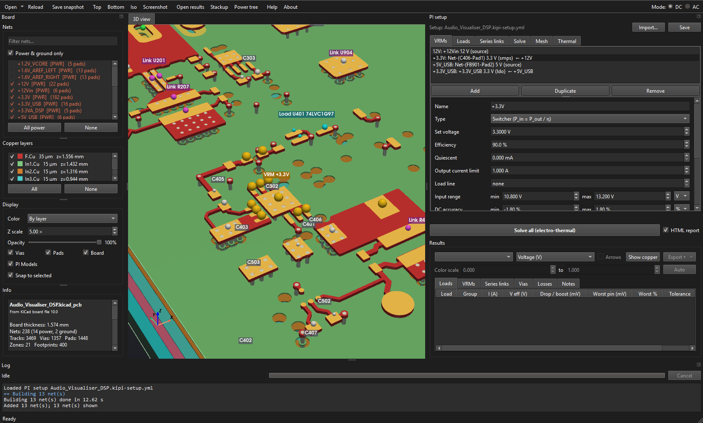

The **Power tree** toolbar button opens a block diagram of the modelled power network, left to right in
the direction power flows: sources and regulators (each VRM type in its own color and
tag), the rails they drive, series links, and the loads and capacitor models on each rail.
It redraws as the setup changes and can be saved as a PNG.

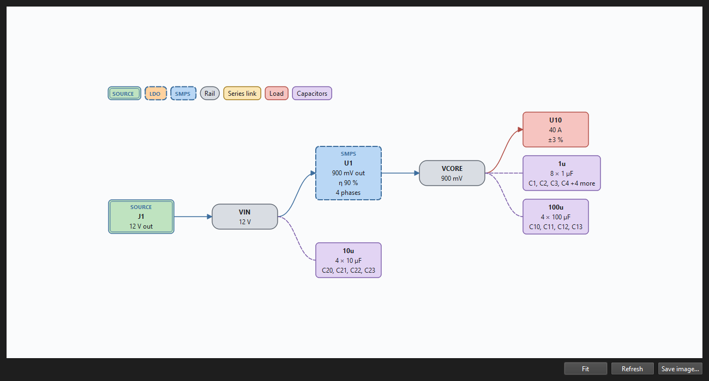

The **Stackup** toolbar button opens a window listing every copper and dielectric layer
with its thickness (in µm, mm, mil or oz), each dielectric's material, εr and thermal
conductivity, and each copper layer's conductor and resistivity, with the copper
**Resistivity** and **TCR** for the whole board, and the AC solve's dielectric **Loss
tangent** and **Default εr** (for dielectrics KiCad gives no εr). The stackup is locked to KiCad's values by
default; untick **Lock to imported values** to try other thicknesses, materials and εr
(choosing a material from the list sets its typical εr and thermal conductivity, and both
can be typed over). Every DC
and AC analysis uses the edited stackup, and the setup keeps it. A copper layer's conductor
(copper foils, silver, gold, aluminum, nickel or tin) sets its resistivity, TCR and thermal
conductivity, and like the thicknesses is changed with the lock unticked; locking again keeps it as set. This can be used to explore how material and thickness properties impact power distribution performance. KiCad's API cannot change a
board's stackup yet, so enter a stackup you settle on in KiCad's Board Setup yourself.
Beside the table, a cross-section draws the layers to scale with their thicknesses, and
follows the thicknesses as they are typed. The solder mask and silkscreen on each side are
listed above and below the copper, read from the board (KiCad gives a silkscreen no
thickness, so KiPI takes 15 µm); their thicknesses can be changed too, and do not add to
the board's.

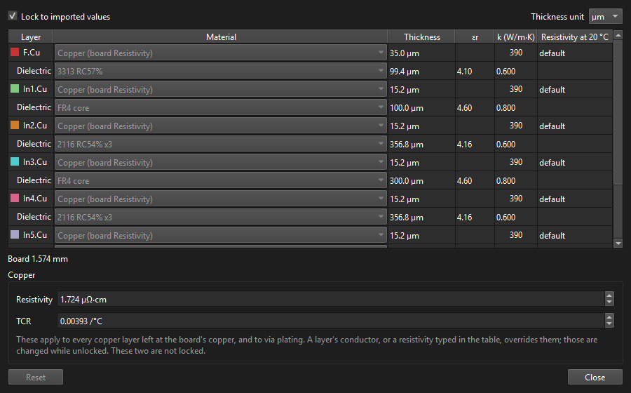

Toolbar buttons set **Top / Bottom / Iso** views and save a **Screenshot…**. Drag to rotate,
scroll to zoom and shift-drag (or middle-drag) to pan. In the 3D view, **Home** snaps to the
iso view; the [user guide](docs/help.html#keys) lists every keyboard shortcut. **About** shows the KiPI version and
project links, and **Copy version info** copies the versions of KiPI, Python and its
libraries for a bug report.

### 3. Model the Power Distribution System

The **PI setup** panel on the right enables setup of the power tree. Each list has **Add**,
**Duplicate** and **Remove** buttons. Hover over any field for a tooltip saying what it does.

**Import…** at the top of the panel fills the power tree from a Tomachie power-tree file
(`<design>.pdn.json`, read from the schematic and the parts' datasheets): each rail's source,
regulators as LDOs or switchers with their input pins, efficiency, quiescent current, dropout
and input range, load switches and series parts as DC connections with their DC resistance,
and each load's current and tolerance (the rail's stated range, raised to the datasheet's
minimum supply voltage where that is higher). Schematic nets are matched to board nets through
the pads. KiPI solves one value per item, so where the file gives a range the typical current
or resistance is used; the log lists every minimum and maximum left out, every current the
file does not know (imported as 0 A, to fill in by hand) and everything that could not be
placed on the board. Settings, thermal and the AC setup are kept. Review the result, then
solve.


Pins are chosen with a picker: pick the net, then the part (type to search), then optionally
the pin numbers (e.g. `1,2,5`; blank means all of that part's pins on the net). Problems such
as missing pins, or two VRMs on one group, are shown in red as you edit.

**VRMs tab**: one entry per regulator, power input, or ideal supply.

| Field | Meaning |
|---|---|
| Type | **Source** (ideal supply), **LDO** (I_in = I_out + I_q) or **Switcher** (P_in = P_out / efficiency) |
| Output pins, Set voltage | Where it drives, and to what voltage |
| Input pins | LDO and switcher only. The pins it draws from, which ties this VRM to its upstream net and defines the power tree. |
| Efficiency / Quiescent | Switcher efficiency, LDO quiescent current |
| Output current limit | Optional: the VRM PASSes if its total output current (all phases) is at most this. Leave at **no limit** to skip the check. |
| Load line | Optional, in mΩ: the VRM regulates to its set voltage less this times its output current (what its connected loads and downstream VRMs actually draw). Drops are still measured from the set voltage, so the droop counts against load tolerances. |
| Dropout | LDO only. The least input-to-output difference it regulates at |
| Input range | Optional input range it regulates over: min and max, in V, or in ±V or % from the input rail's nominal voltage (the set voltage of the VRM driving it). A VRM whose solved input voltage is outside its range, or an LDO below its dropout, cannot hold its set voltage: every load it feeds, directly or downstream, is marked **VRM OUT OF REGULATION** |
| DC accuracy | LDO and switcher only. Optional DC error of the output: min and max, in % or ±V from the set voltage, or in V. The target calculator can subtract its larger side from the AC voltage tolerance. |
| Sense pins | Optional remote sense: the VRM regulates the voltage at these pins instead of at its output |
| Ground pins | Optional: also solve the ground return, so the drop is measured output-to-ground |
| Ground sense pins | Optional negative remote sense on the ground net: the VRM holds its set voltage relative to these pins instead of 0 V (needs ground pins) |
| Phases | Parallel phases of a multi-phase regulator. **Edit phase** picks which phase the output, input and ground pins belong to. |

KiPI automatically calculates the input current into the input pins on a VRM based on the efficiency, type, and output power (which is based on defined loads).

**Multi-phase VRMs**: set **Phases** above 1, then choose each phase in **Edit phase** and
give it its own output pins (e.g. its inductor), input pins and ground pins. A new phase
takes the next parts in sequence (`L1` → `L2`, `Q1` → `Q2`), or on a board annotated by
schematic sheet the same parts on the next sheet (`L101`, `Q101` → `L201`, `Q201`), or copies the previous one when
there is no next part, so check its pins. All phases share the VRM's set
voltage, type, efficiency and sense pins. Each phase carries an equal share of the output
current and settles at whatever voltage its copper needs to deliver that share. The VRM
regulates its sense pins or, without them, the average of its phase outputs. Each phase draws
its own input current and returns its own ground current. The VRMs results tab lists every
phase under its VRM.

To try it without a design of your own, open the example board in
[`examples/multiphase_buck`](examples/multiphase_buck): a 4-phase 12 V → 0.9 V, 40 A core rail
(`python -m kipi --snapshot examples/multiphase_buck/multiphase_buck.kipi.json.gz`).

**Loads tab**: one entry per consumer (Can be multiple unique consumers for a single refdes).

* **Supply pins** and **Current**. With several supply pins, **Current split** chooses
  between splitting the current evenly over all pins and giving explicit **pin groups**,
  each with its own current (**Add pin group**, or **One group per pin**). Use groups when one
  part draws different currents on different rails or pins, e.g. a core and an I/O supply.
* **Ground pins** (optional) include the ground return. KiPI superimposes all VRM and load return currents to form a comprehensive GND plane current model.
* **Tolerance** is the PASS/FAIL limit: a min and a max, each optional, in % from the VRM
  set point (e.g. -3 % / +5 %), in volts from it (±V, e.g. -0.1 / +0.15 V) or in volts (e.g.
  3.135 to 3.465 V). A load passes when every
  pin is within it, none below it (a **drop**) or above it (a **boost**). Boosts
  happen with remote sense, where the VRM raises its output pins to hold a sense point
  further down the copper, so pins nearer the VRM sit above the set point. A load on a net
  group whose solve did not converge shows **NOT CONVERGED** instead of a result.
* Before solving, KiPI checks that every load pin reaches its VRM through copper or series
  links. Unconnected pins draw nothing: the load's current goes through its other pins, or,
  with no supply (or ground) pin connected, is left out and the load shows
  **DISCONNECTED**. The Notes tab lists every unconnected pin. A rail with no load connected
  at all stops the solve.

* **Load models** (**Model ▾** under the list): a part's supplies in a YAML file of their
  own, with each supply's pins, current or pin groups, tolerance and heat, and its AC target
  or the load step it comes from. **Export a part's model** writes every load and probe on
  one reference designator; **Apply model file to loads** sets them on any number of loads
  at once, each from the supply chosen beside it; **Add loads from model file** adds one load
  per supply on every part ticked that has the supply's pins. The Probes list has the same
  menu for targets. A model by hand:

  ```yaml
  kipi_load_model: 1
  part: XC7A35T-1CSG324C
  supplies:
    - name: VCCINT
      pins: [F7, F9, H7]
      current_a: 1.2
      tolerance: {min: -3, max: 3, unit: "%"}     # V, ±V or %
      load_step: {step_a: 0.6, slew_a_per_us: 5, ac_tolerance_mv: 30}
  ```

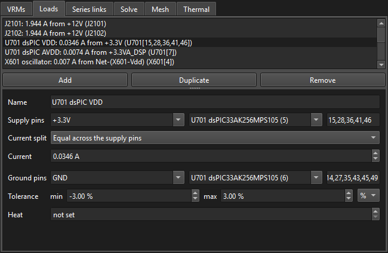

**Series links tab**: parts that pass DC from one net to another, such as sense
resistors, ferrite beads, fuses, load switches and 0 Ω links. Give **Side A pins**,
**Side B pins** and a **Resistance**. Side A on a two-terminal part fills in side B on its
other net. A new link starts on a part that bridges the first two ticked nets that aren't
grounds, if there is one. When both sides are on the same resistor (reference `R…`),
the resistance is read from its value field: `10m`, `0.005`, `4k7`, `0R1`, `5 mΩ` and the like
all work, and anything after the value (`1% 0603`) is ignored. You can still type your own.
Nets joined this way are solved together as one rail, and each rail may hold only one VRM.
A net with no connection to its VRM is reported, not guessed at. **ESL** is only used by the AC
analysis. I squared R losses in series links are calculated. **In order to assign a series link, the nets on either side must both be defined as power nets in the net selection pane**. In practice, 0 ohm resistors are never possible; Check your jumper's datasheet for max DCR.

**Solve tab**: every combined rail, with a checkbox. Untick the rails that are not modeled or
routed yet to solve the rest; only the ticked rails are validated, and the choice is saved.
Where a solved rail meets an excluded one, a VRM whose output is excluded becomes a constant
load on its input pins (the input current its rail would need at nominal voltages), a VRM
whose input is excluded becomes an ideal source, and ground pins on an excluded ground are
ignored. The Notes tab lists these substitutions.

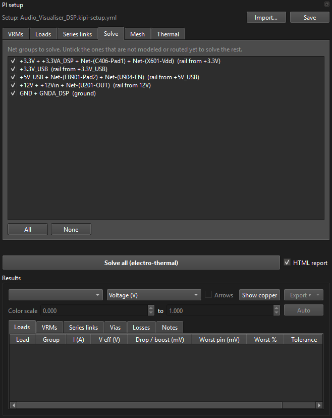

**Mesh tab**: **Max edge** is the largest FEA mesh triangle edge in mm; smaller is more accurate and
slower. **Via grading** controls how fast the mesh refines towards plated holes.

**Via plating** is a table of rules, first match wins: hole type (through, blind, buried,
microvia, component hole, or any), a drill-size range, the plating thickness, and what a
FILLED hole of that rule is filled with. The drill is the hole made in the laminate;
plating grows inward from it, so a barrel is a copper tube of the drill's outside diameter.
A via the KiCad board marks as filled carries its core too when the fill conducts: copper
fill makes the whole hole copper, conductive epoxy adds its core at the resistivity you
enter, and non-conductive epoxy adds nothing. A via whose fill is left to the design rules
(or a board format that does not say) is solved unfilled, and the Notes tab counts them.
The defaults are IPC-6012 Class 2 minimum average plating (through and blind 20 µm, buried
13 µm, microvia 12 µm); set what your fabricator states. Each via's pad is read per layer
from its padstack, so a pad removed from an unused inner layer is not counted as copper.

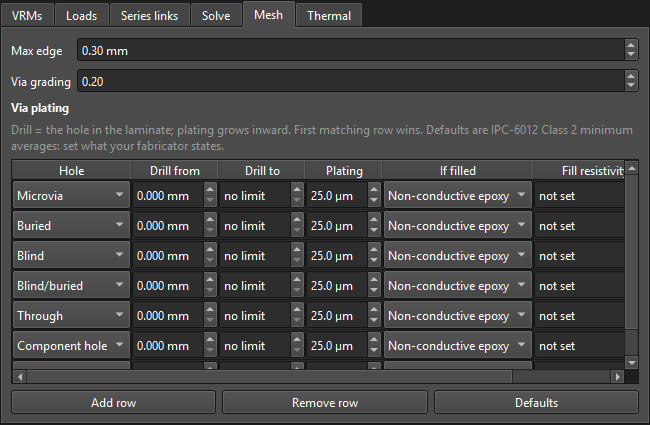

**Thermal tab** (off by default): tick **Electro-thermal co-simulation** to make losses heat
the board and the warmer copper become more resistive. The heat is the copper and via
losses, the DC connections, each VRM's conversion loss and, if you include it, each load's
power. The Notes tab and the report list the heat by source.

Each copper layer has its own temperature. Heat goes onto the layer it is made on (a part's
heat on the layers of its pads), crosses the laminate to the layers above and below, and goes
down plated holes on any net, so thermal vias count. Only the top and bottom layers lose
heat to the air, through their solder mask and silkscreen, which hold a little of it in.
Solving each layer on its own was inspired by
[KiCad Thermal Sim](https://github.com/PoeAlex/KiCad_Thermal_Sim) by
[PoeAlex](https://github.com/PoeAlex), a KiCad plugin for heat spreading
across copper layers.

Set:

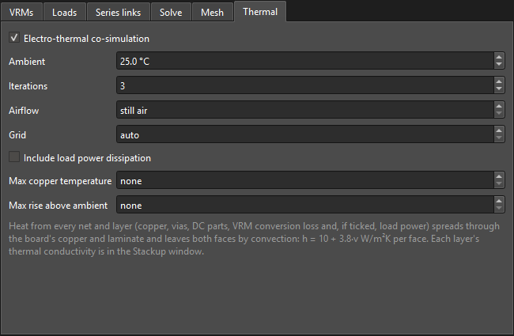

* **Ambient** temperature.
* **Iterations**: three is usually enough. The Notes tab shows how much each iteration
  changed.
* **Airflow** in m/s.
* **Grid**, the thermal cell size: *auto* gives about 250 cells across the board.
* The laminate's in-plane thermal conductivity is each dielectric's **k** in the Stackup
  window, looked up from its material (FR4, prepreg types, polyimide, Kapton, PTFE, Rogers,
  ceramic, aluminum…; unrecognized names fall back to FR4 with a warning) or typed in there.
  Its conductivity through the thickness is the material's typical value (FR4 core
  0.3 W/m·K, against 0.8 in-plane); a typed k keeps the material's ratio of the two.
* **Include load power dissipation** (off by default): each load also heats the board with
  the power it draws, the sum over its supply and ground pins of pin current × pin voltage,
  spread over those pins. DC connection (series link) I²R losses always heat their pins.
* **Max copper temperature** and **Max rise above ambient** (optional): copper hotter than
  either limit, on any layer, is marked FAIL in the Thermal results tab. Changing them grades
  the last solve straight away.

The setup is saved as `<board>.kipi-setup.yml` (YAML) next to the board when you click
**Save** at the top of the panel and every time you solve. It travels with the project and
can go into version control. Setups saved as `<board>.kipi-setup.json` by earlier KiPI
versions still open, with a warning that JSON setups are deprecated; the next save writes
the `.yml` file, which is read from then on. AI Agents can make quick work of power tree modelling by editing this file directly if they have knowledge of the file format from this codebase as well as the components in your design from your schematic.

**Data Prepoulation**: As you pick pins when setting up the power tree, KiPI pre-fills the fields that usually follow from those selections. Every prepopulation can be changed, and a field the extracted board gives no answer for is left as it was:

* **VRM set voltage** from the output net's name: `+3V3`, `3.3V`, `V1P8`, `VDD_0V75`, `-5V`,
  `VBUS` (5 V).
* **Ground pins** of a VRM, load or AC probe: the same part's pins on its ground net. Grounds
  aren't always called GND, so KiPI tries grounds the setup already uses, then names like
  `GND`, `PGND` or `VSS`, then the board's biggest net if it isn't named like a rail.
* **VRM input pins** (LDO or switcher): the output part's pins on its other rail, if it has
  exactly one.
* **Series link side B**: side A on a part with pads on just two nets (a resistor, ferrite or
  fuse) puts side B on its other net, and a resistor's value becomes the resistance.
* **New phases** of a multi-phase VRM take the next parts in sequence: `L1` → `L2`,
  `Q1` → `Q2`. On a board annotated by schematic sheet (from the sheet number × 100 or
  × 1000) they take the same parts on the next sheet: `L101`, `Q101`, `Q102` → `L201`,
  `Q201`, `Q202`, when all of them are there. A step set by earlier phases is kept
  (`Q2`, `Q4` → `Q6`).
* **Names** follow the picked part while they are still its reference.

### 4. Solve

Click **Solve all** (If rails are unticked in the Solve
tab, Solve x of n will be displayed). Every rail is meshed and solved, the downstream loads first and then
back towards the source, so each VRM's input current includes everything it feeds. Progress
and solver residuals stream into the log; **Cancel** stops the run.

Tick **Report** before solving to also write
`<board>_kipi_report_<date>_<time>.html` next to the board (the time stamp keeps each
solve's report rather than overwriting the last). It opens in your web browser when the solve finishes, and **Open report** opens it
again later. Choose **PDF** beside it for a `.pdf` to print or attach instead: the same
tables and maps, with the interactive 3D views in a web page attached inside the PDF
(`<report>_3d.html`; its **3D Results View** link, or the paperclip beside it, opens it in
your browser). Its User notes box is a form field:
type in it in Acrobat, a web browser, Preview or most other PDF viewers and save the PDF to
keep the notes (printed, it is a box to write in). The HTML report is a
single portable file, containing:

* the summary and every results table;
* an interactive 3D view per rail (rotate, zoom, hover for values);
* per-layer statistics, with top-down voltage and current-density maps;
* the board temperature map when thermal is on.

Both the DC and the AC report have a **User notes** box at the end, after every
result: click it and type what was checked, by whom, or what to change. A browser cannot
write to a file it opened, so the notes are kept in that browser as you type (they are
there the next time you open the same file) and **Save a copy with notes** downloads the
report with the notes in it, to keep or share. Notes print with the report; an empty box does not.

| Summary tables | Interactive 3D per net group |
|---|---|
| 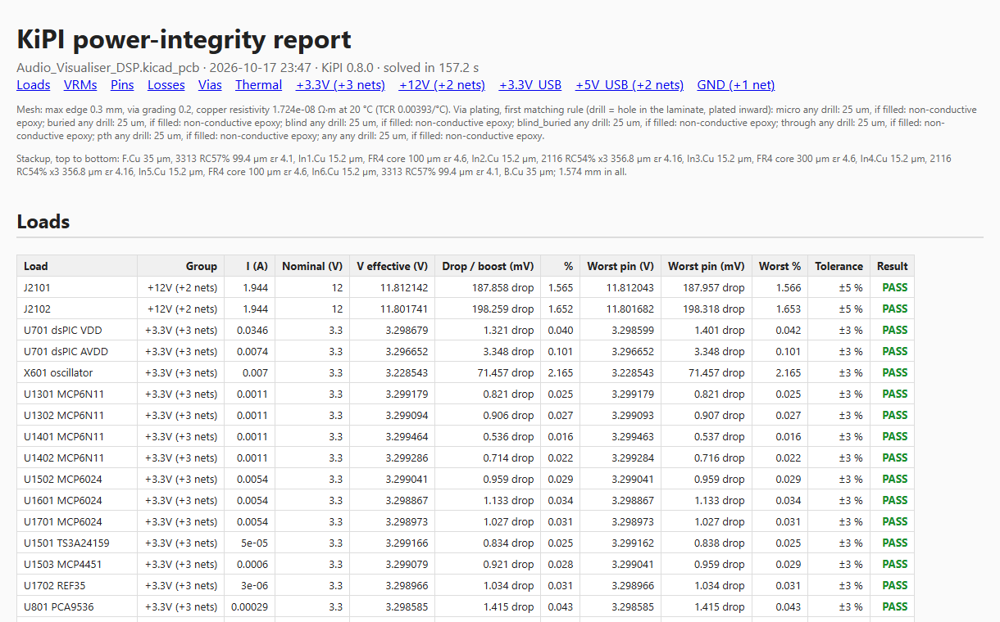 | 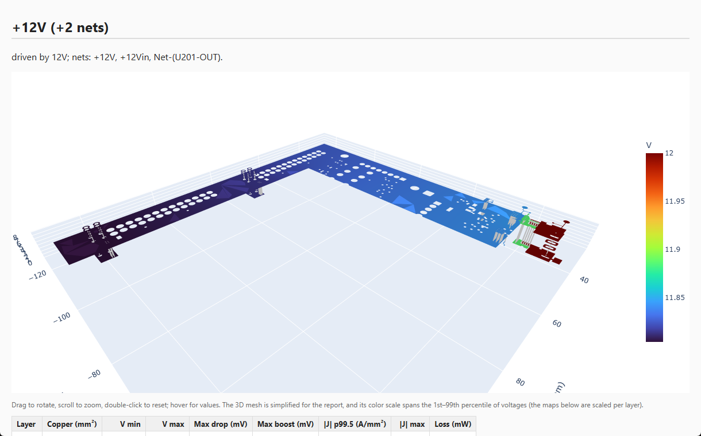 |

### 5. Read the results

In the **Results** pane, choose a **net group** and a **field** to show in 3D:

* **Voltage**
* **Current density**. Tick **Arrows** to see where and which way the current flows.
* **Power density**
* **Via current**
* **Temperature** (with thermal on)

Voltages are measured against the source's ground pins (0 V). When ground returns are
solved, the ground under a load rises above 0 V, so a supply plane can read above its VRM's set
point even though a remotely sensed rail is exactly on target. The Loads tab's effective
voltage (supply minus ground at the load) is the figure to compare with the load's voltage requirements.

The color scale covers the whole result, on every layer. To look closer, type a minimum and
maximum in the **Color scale** fields under the result field (for temperature, say ambient
to your limit); values outside take the end colors. Limits are kept per net group and field
(temperature: for every group) until **Auto**. (Automatic current and power density scales
clip at the 99.5th percentile, since pad corners spike; the probe still reports true values.)

Click any point on the copper or vias in the 3D results view to probe it: the Info box gives the voltage, its drop
or boost from the VRM regulation voltage, current and power density, and the pad or via probed. **Show
copper** returns to the plain geometry view; pick the rail in the results pane again, or another field, to get
the results back without resimulation.

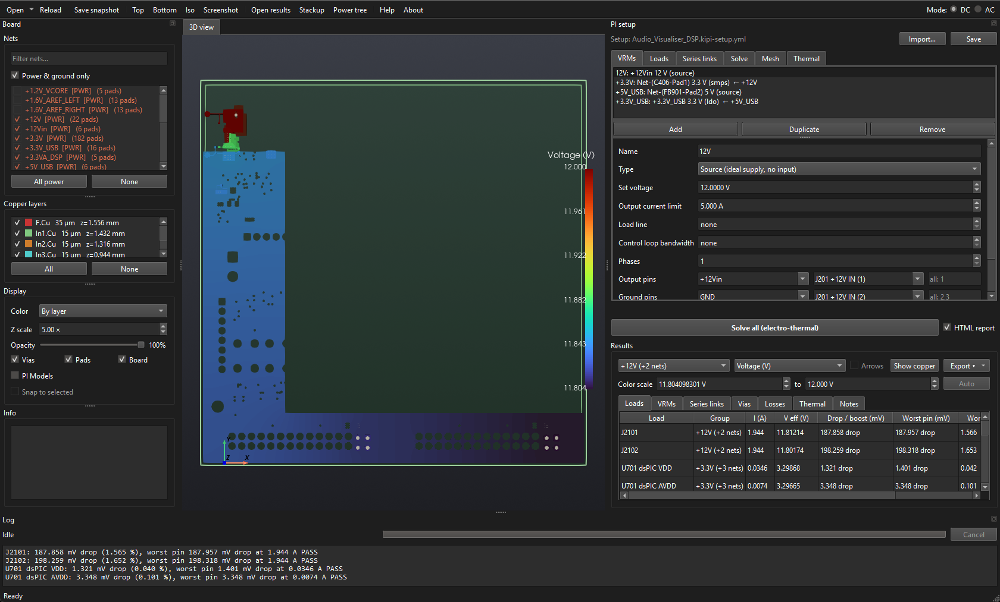

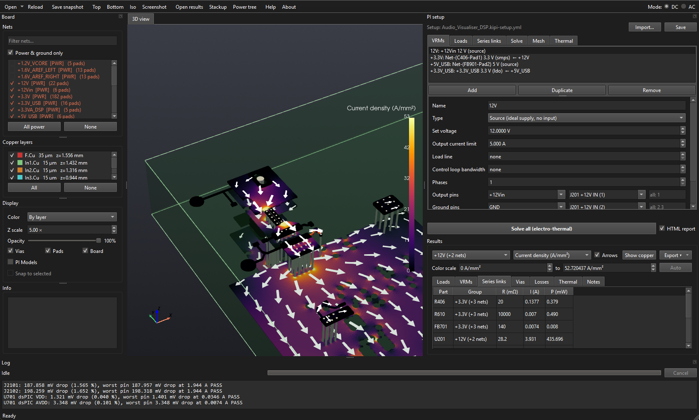

| Via current | Temperature |
|---|---|
| 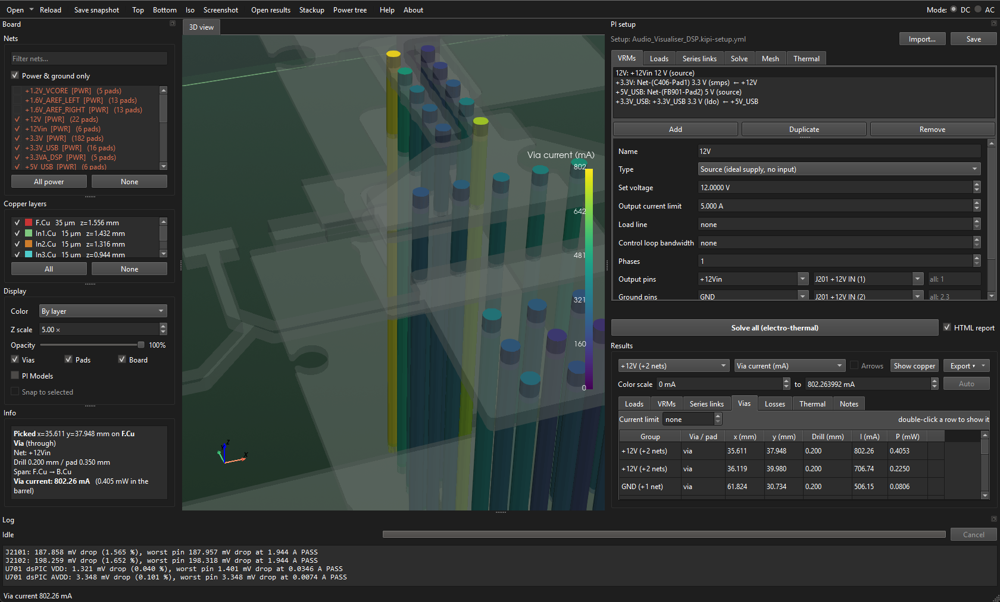 | 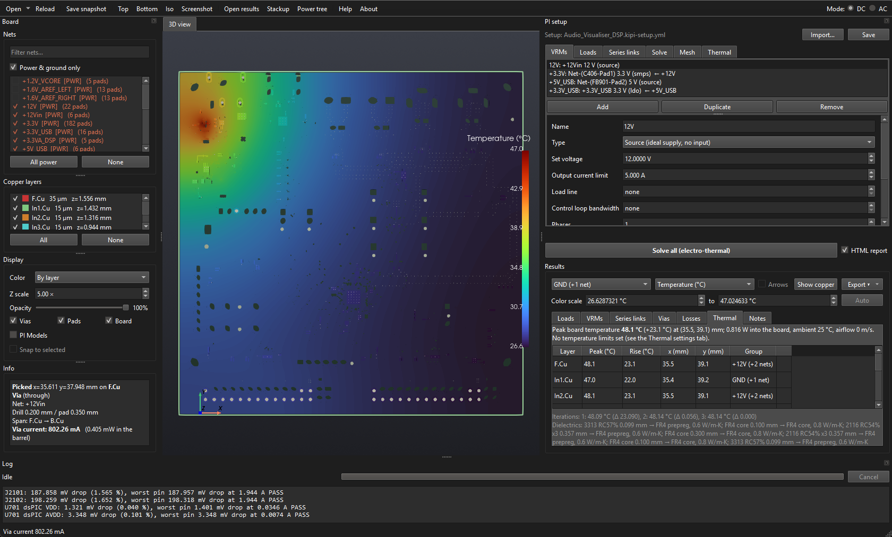 |

Result tabs (click a column header to sort by it; click again to reverse). The setup's
tables (capacitor parts, custom target points, load pin groups) and the HTML reports'
tables sort the same way:

| Tab | Shows |
|---|---|
| Loads | Each load's current, effective voltage, drop or boost, worst pin and PASS/FAIL. Double-click to show its group. |
| VRMs | Output and input voltage, current and power, conversion loss, and PASS/FAIL against the output current limit, with a row per phase for multi-phase VRMs |
| Series links | Current and loss in each series part  (I squared R losses)|
| Vias | Every via and PTH barrel ranked by current. The **Current limit** for PASS/FAIL starts at 1 A, a placeholder: set your own, or 0 for none. Double-click a row to fly to it. |
| Losses | Copper loss per group and layer, vias, series links and VRM conversion |
| Thermal | After an electro-thermal solve: the hottest copper on each layer, its rise and location, PASS/FAIL against the temperature limits, the iteration history and the dielectric conductivities used. Double-click a row to show that group's temperature. |
| Notes | Solver details, warnings and the thermal iteration history |

**Export ▾** writes the tables as CSV (including `_pins.csv`, with the voltage and current
of every pin each rail was solved with, which the HTML report also lists), the 3D
results as a ParaView `.vtm`, or **Save
results…** as a `.kipi-dc-results` file, or `.kipi-dc-thermal-results` after an
electro-thermal solve (named with the board and the time by default), which the toolbar's **Open results…** reloads without
solving again (load the board first). Results files hold JSON and NumPy arrays in a zip:
they open on any computer and cannot run code, so they are safe to share. The 3D views are
rebuilt when the file opens. Results saved by KiPI 0.7 and earlier are Python pickles, which
can run code; KiPI asks before it opens one, and saving it again writes the new format.

### 6. AC: PDN impedance

Switch **Mode** to **AC**. The setup panel becomes the **AC setup**, which shares the VRMs and
series links with DC mode (every VRM field can be edited in either mode) and adds:

* **Capacitors tab**: RLC models (capacitance, ESL, ESR) for the decoupling capacitors, each
  shared by a group of identical parts. **Models from values** makes one model per capacitor
  value that has none yet, reading the capacitance from the value; enter the ESL and ESR
  from the datasheet. The table lists every capacitor between ticked nets: tick parts to
  assign them to the selected model, with **Tick same value**, **Tick same footprint**,
  **Tick same value + footprint**, **Tick shown** and **Untick shown** for many at once.
  The table shows each part's footprint, so 0402 and 0603 parts of one value can get
  different models. Enter only the part's own ESL: its mounting (pads,
  vias, planes) is simulated. **Important**: Ensure that capacitors of the same value in different case sizes are modelled independently, as no two capacitors are created the same.
  A ceramic model (X5R, X7R…) with a **Voltage rating** is derated by the DC voltage across
  each of its parts: enter the rating and how much capacitance it **Keeps at rating**
  (from the datasheet's DC bias curve; 40 % by default). The voltage is what the last DC
  solve found across each part, or else the rail's VRM set point. **Models from values**
  reads the rating from values such as `10uF 6.3V X5R` for class II dielectrics.
  A model's **Dielectric** (X7R, X5R, Y5V…) fills in its typical **Aging** rate, in % of
  capacitance lost per decade of hours (enter the datasheet's rate if it gives one), and
  gives its capacitance a typical temperature curve.
  **Models from values** reads the dielectric from the value too.
  **Manufacturing tolerance** is optional: the part's capacitance tolerance in %, from its
  datasheet or value code (J ±5 %, K ±10 %, M ±20 %), applied by the sweep setting below.
* **Probes tab**: Defines where to plot the PDN impedance, usually a device's supply and ground
  pins. **From DC load** adds a probe on the same pins as a DC load you pick from its dropdown, or on an LDO's or switcher's input pins (one entry per phase). Each probe has a target impedance and frequency range: **flat** (an impedance up to a frequency) or **custom**, a
  piecewise-linear mask through frequency/impedance points on the log-log plot.
  **Target Impedance/Frequency Calculator** works out a flat target from the device's AC
  voltage tolerance, load step and slew rate: Z = V / ΔI, up to f = 1 / (π · t_rise).
  It can copy the tolerance and the load step from the DC load on the probe's pins, and
  subtract from the tolerance both the DC accuracy of the VRM driving the rail and, from the
  last DC solve, the **DC drop at the load** itself: how far that load's effective voltage
  sits from its VRM's set point (solve the power tree first, or the button is disabled).
  Targets apply only above the rail's VRM **Control loop bandwidth**: the AC solve leaves
  the VRM out of circuit (the open-loop PDN impedance, capacitive only), and below its bandwidth the
  converter's control loop is assumed to hold the rail. If the bandwidth is at or above the target frequency,
  the target across all swept frequencies are judged and the results say so. The method follows Smith et al.,
  ["Power Distribution System Design Methodology and Capacitor Selection for Modern CMOS
  Technology"](https://doi.org/10.1109/6040.784476), IEEE Trans. Adv. Packaging, 1999.
* **Sweep tab**: start and stop frequency, points per decade, and how many copper field
  solves per decade (the copper's response is interpolated between them). **Capacitor DC
  bias** turns the DC bias estimate on or off for every model at once. **Capacitor
  manufacturing tolerance** solves every model that has a **Manufacturing tolerance** at the
  low end of it (subtracting it: a ±10 % model keeps 90 %), the worst case for a PDN.
  **Capacitor aging**
  ages every model with a dielectric by the **Hours operated** (ten years by default; type
  them, or drag the slider that shows while aging is ticked), on top
  of its DC bias: each loses its aging rate per decade of hours past 1000 hours.
  **Temperature** sets the copper's resistivity and the capacitance of models with a
  dielectric: **Fixed** at one board temperature, or **From DC thermal co-simulation**, the
  copper temperatures of the last DC solve with thermal co-simulation (or of DC results
  opened from a file).
* **Mesh tab**: mesh size and minimum edge at plated holes (which sets the via inductance).
  The dielectric loss tangent and default εr are in the Stackup window.

| Capacitor models | Target calculator |
|---|---|
| 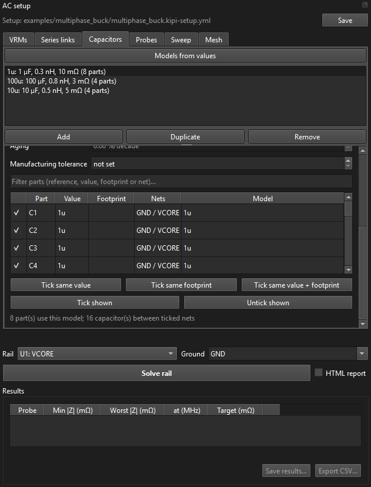 | 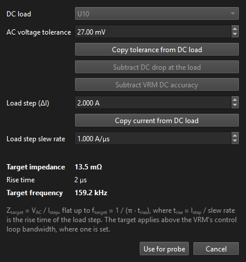 |

Pick the **Rail** (by its VRM) and **Ground** under the tabs and click **Solve rail**. The copper
of the rail and its ground is field-solved as a 2.5D model with both faces of every sheet:
plane resistance with skin effect, spreading inductance, plane-pair capacitance and cavity
resonances, and via inductance all come out of the mesh. The capacitors and series links are
then attached at every sweep frequency. The VRM itself is not modeled as an impedance, so the
curve keeps rising towards low frequency as the bulk capacitance approaches an open circuit.
**Important:** AC analysis is a massive compute problem. Adding many probes and finer mesh explodes simulation time dramatically. During solving, the frequency being solved is displayed in the log output window.

The result opens in the **Impedance** tab next to the 3D view: |Z| against frequency for every
probe, with its target dashed in the same color. Click a curve to place a cursor; drag it or
use ←/→ (Shift: ×10) to move along the curve, ↑/↓ to change curve, and Esc or right-click to
remove it. The **Board map** tab beside it shows the solve from above while it runs and
after: the mesh of the rail and its ground, layer by layer, with the probes and the
capacitors marked by model. The Info box shows the cursor's frequency, |Z|, phase, R and X, the reactance as an
equivalent L or C, PASS/FAIL against the target with the margin in dB at the cursor frequency, and every other
probe's |Z| at that frequency. The results table gives each probe's minimum and worst |Z|
(closest to, or furthest over, the target) and PASS/FAIL; the notes list the capacitors that
were left out for having no model. Each rail keeps its last result, so switching **Rail** shows
another rail's curves without solving again. **Export CSV…** writes |Z|, R and X at every
frequency. **Save results…** writes every solved rail to a `.kipi-ac-results` file, which
**Open results…** reloads in AC mode (load the board first). Like DC results files, these are
JSON and arrays in a zip, safe to share.

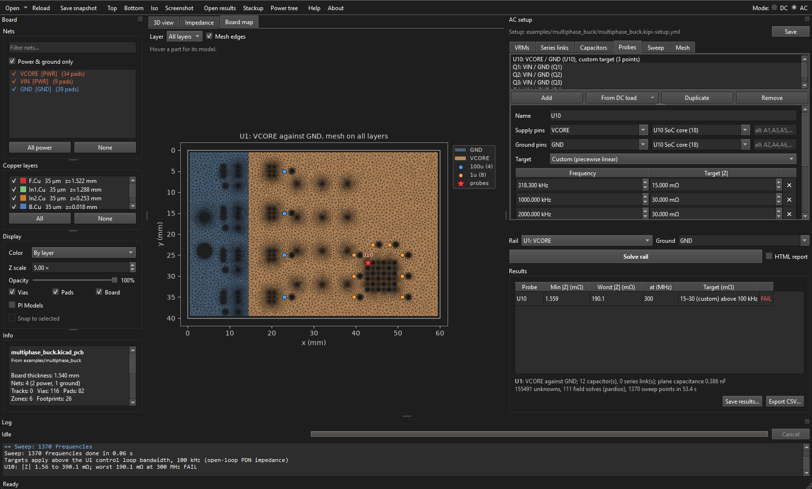

Tick **Report** next to **Solve rail** to also write
`<board>_<rail>_ac_report_<date>_<time>.html` next to the board after each solve. It opens in your web browser when the solve
finishes, and **Open report** opens it again later. Choose **PDF** for a `.pdf` instead,
with images of the |Z| plot and the board map. Like the DC report, it is one
portable file you can share. It has the probe table with margins, an interactive |Z|
plot with the targets and each capacitor model's own curve, a board map of the rail's copper
with the probes and capacitors marked, the capacitor models, the sweep, mesh and solver
details, and the same User notes box as the DC report.

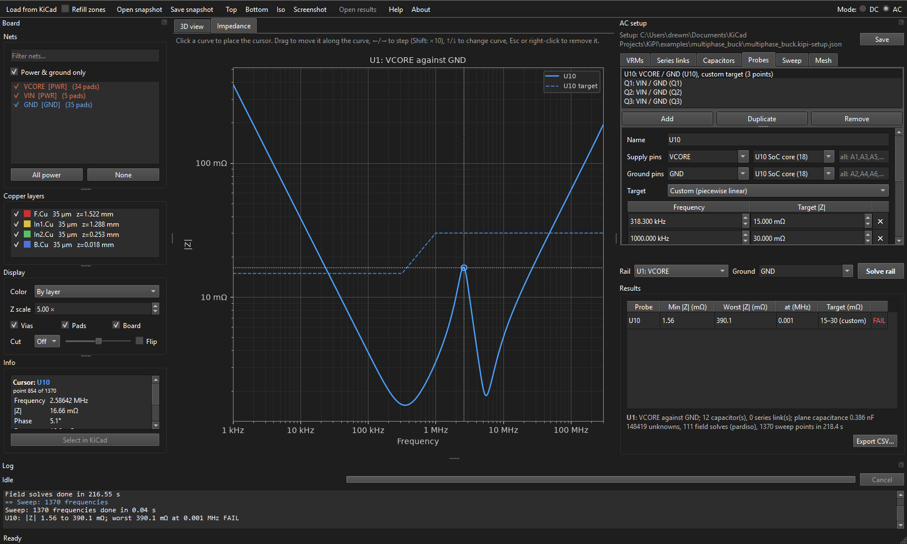

### 7. Coupled Noise

Switch **Mode** to **Noise**. The **Coupled Noise setup** treats one of the setup's
**Switcher** VRMs as an *aggressor* and the signal nets you name as *victims*. The
screenshots below are the `examples/validation/coupled_noise` example: a 12 V to 1.8 V,
1 MHz buck over a ground plane, with three victims. SIG_SW runs beside the switch node's
pour, SIG_LOOP beside the hot loop's input track, and SIG_BURIED under SIG_LOOP on an inner
layer, behind the ground plane. Open its snapshot to try it.

* **Aggressors tab**: **Add** makes an aggressor from a switcher VRM and fills each phase
  from the board: the switching device's pins, the inductor and its value, the switch node
  and the input and output capacitors. Give the switching frequency and edge times; the
  input and output voltages and the load current come from the DC setup unless you enter
  them. **Coss**, **Rds(on)** and **package inductance** from the datasheet are optional.
  KiPI draws the hot loop through the copper and computes its inductance, which with the
  switch node's capacitance sets the ringing on every edge. The ringing's current flows
  round the hot loop too, through the input capacitors, and couples onto victims.
* **Victims tab**: each victim is a net with its driver and receiver pins (guessed as the
  net's farthest-apart pads when left blank) and a **Type**: CMOS push-pull, open drain,
  series or parallel terminated, an LVDS leg, an analog input, or high impedance
  (undriven: a tri-stated or floating net). The type fills in the
  driver and receiver resistances, the receiver capacitance and any termination. An open
  drain has a separate **Driving low** resistance: the line is held by its 4.7 kΩ pull-up
  when high, and by the switch when low. The **Logic level** gives the JESD8 levels and so
  the noise margin (400 mV for 3.3 V CMOS), unless you enter one.
* **Capacitors tab**: the same capacitor models as AC mode.
* **Settings tab**: the harmonics kept, the ringing's least damping, how finely victim
  traces are cut into cross-sections, and the **Board model**: AC mode's field model of the
  converter's rails and ground. It splits the ripple current among the capacitors through
  the copper's own impedance and gives the shared-ground noise. It is the slow part of a
  solve; untick it for a quick look.

Pick the **Aggressor** and click **Solve**. The waveforms are exact Fourier series of the
converter's piecewise-linear shapes, so they appear in well under a second, and the victims
follow. Tick **Scan nearby nets** to also estimate every signal net near the aggressor and
solve the worst in full. Their real drivers are not known, so they are solved as undriven,
the worst case for capacitive coupling, unless **Scan: victim type** in Settings says
otherwise; a net that is a victim already keeps its own type. The **Waveforms** tab plots the switch node of every phase with its
ringing, the inductor currents, each capacitor's ripple current and the rails' ripple
voltage, in time or, with **Spectrum**, as harmonics. The notes give the hot loop's
inductance, the switch node's capacitance and the ringing's frequency and damping.

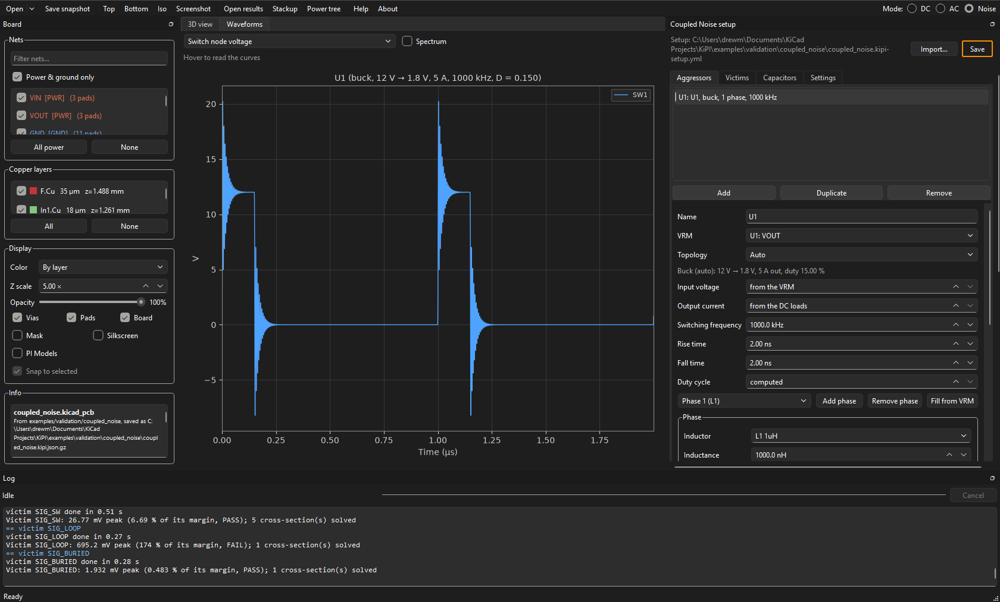

The **Results** table lists each victim's peak noise at its receiver, its margin, the share
of the margin used, the dominant mechanism and PASS or FAIL. Select a victim to plot its
noise under **Victim noise**. By default the plot shows the superposition of every
mechanism; tick **Capacitive**, **Inductive** or **Common ground** to add each mechanism's
own curve, and **Driver end** for the noise at the other end of the line.

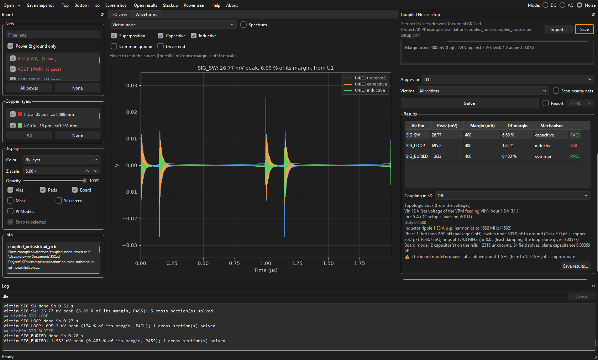

**Victim held high and low** draws the receiver's line as it really sits: at VOH with VIH
below it, and at VOL with VIL above it, with the noise on each. Each plot gives how far the
noise reaches toward its threshold and what share of that state's margin it uses. An
open-drain line is solved once per state, as its driver holds it far harder low than high.

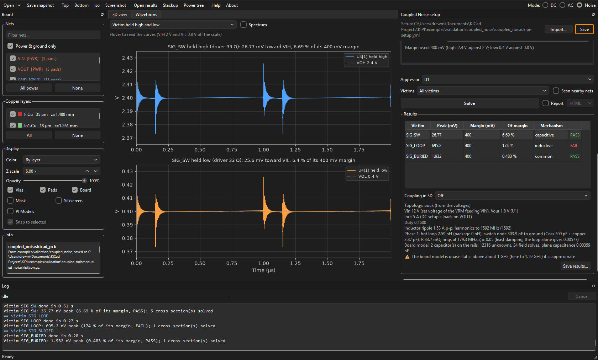

**Coupling in 3D**, under the results table, shows where the selected victim's peak noise
couples in. Each piece of its traces is colored by its share of the receiver's peak: red
adds to it, blue takes from it. Pick the superposition or one mechanism. The common-ground
share is a dot at the driver, and the capacitor loops that induce the inductive noise are
drawn in magenta. The shares add up exactly to the peak, so the brightest pieces are the
ones to move. Below, SIG_LOOP picks up most of its noise near the switching device, where it
runs closest to the hot loop, enough to fail: the hot loop's 179 MHz ringing current
induces most of it.

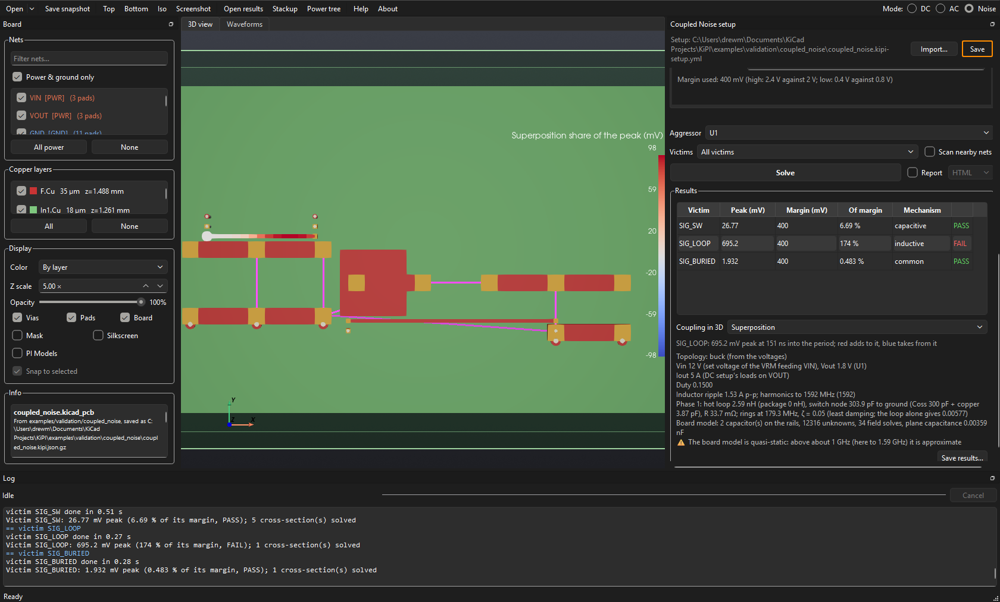

The mechanisms point to different fixes. Capacitive noise comes from the switch node's
dV/dt: keep victims away from its copper or behind a plane, and drive them harder.
Inductive noise comes from the hot loop's dI/dt: keep the loop small and over a solid plane,
and route victims away from it. Common noise comes from the switching current's return:
give the hot loop its own short ground return and keep the victim's driver and receiver
grounds out of it. Tick **Report** for an HTML or PDF report after each solve; **Save
results…** writes a `.kipi-noise-results` file that **Open results…** reopens in this mode.

### Tips and troubleshooting

* **A load shows DISCONNECTED, or "no load on this rail is connected"** usually means unrouted copper, an unfilled
  zone, or a missing series link for a part between them when both have PI models defined.
* **Unexpected voltage drop in results:** compare the board view with KiCad. Thermal reliefs, necked traces and
  via counts dominate DC drop, and the Current density view with Arrows makes the bottleneck
  obvious. Via anti-pad/voids in power planes can have a big impact on power distribution capacity when the plane becomes swiss-cheesed.
* **Slow solves:** raise **Max edge**, or analyze fewer nets at a time. Large planes are cheap
  but very fine traces are not. If you are simulating on an Intel x86 platform, isntall the paradiso multithread solver, as mentioned above. 
* **"KiPI works with one KiCad at a time"** although only one is open: a KiCad that did
  not exit cleanly may still be running; end it in the task manager (the message gives its
  PID). If the check is wrong for your setup, set the environment variable
  `KIPI_ALLOW_MULTIPLE_KICAD=1` before starting KiCad to skip it. This is enforced because the IPC plugin interface only supports one board instance.
* **No part models:** the log says why. KiPI needs KiCad's `kicad-cli` (it looks in the
  connected KiCad, the PATH and the usual install folders; set `KIPI_KICAD_CLI` to its
  path otherwise) and the board's `.kicad_pcb` file on disk; without one, click **Guess models**. A part whose model file KiCad
  cannot find is named with the missing path; KiCad's own 3D viewer shows the same gap.
* **Logs:** each session writes to `kipi/kipi-<date>-<time>-<pid>.log` in the temporary
  folder (`%TEMP%` on Windows, `$TMPDIR` on macOS, `/tmp` on Linux), and the last
  15 sessions are kept. A matching `.crash.log` collects native crash tracebacks and, if a
  task runs longer than a minute, a stack dump of every thread. If the window stops
  responding during a task, the log records where the UI thread was stuck. Attach both
  files, and the **About** dialog's version info, to bug reports.
* **Have Fun:** The author asks that you share what projects this package has simulated, and what power integrity issues you have found with it. Conductor simulation gives incredible insight into how PCBs actually function in practice. See what happens when you pump 10 amps into a 5 mil trace with the temperature results view.

## Development

From a checkout, KiPI runs standalone, or as the plugin against the running PCB editor:

```powershell
python -m venv --system-site-packages .venv   # use KiCad's bundled python.exe
.venv\Scripts\pip install -r requirements.txt -r requirements-dev.txt
.venv\Scripts\python -m kipi tests\data\synthetic.kipi.json   # standalone, opening a board
$env:KIPI_HOST = "plugin"; .venv\Scripts\python -m kipi        # the plugin: connect to KiCad
.venv\Scripts\python -m kipi --dump board.kipi.json.gz   # extract from KiCad only, no window
.venv\Scripts\python -m pytest tests
.venv\Scripts\ruff check .                    # lint, as CI does (ruff check . --fix fixes most)
```

KiPI runs as the plugin when KiCad starts it (KiCad sets `KICAD_API_SOCKET`) and standalone
otherwise; `KIPI_HOST=plugin` or `standalone` overrides that (`kipi/host.py`).

`requirements.txt` is what KiCad installs into the plugin's venv: `pyproject.toml`'s
dependencies, which are all standalone needs, plus its `kicad` extra (kicad-python).
`requirements-standalone.txt` is what the launcher installs: the dependencies alone.
`tests/core/test_requirements.py` keeps the three in step. Test and lint tools live only in
`requirements-dev.txt`. After changing the requirements, run
`python .github/scripts/dep_sizes.py` to refresh the package list the launcher shows when
it cannot check with PyPI (a test fails until you do).

The tests follow the package: `tests/core` (geometry, meshing, solvers, KiCad I/O),
`tests/dc` (power tree, thermal, DC reports and panel), `tests/ac` (impedance solve, targets,
AC panel and report), `tests/noise` (waveforms, coupling extraction, victim solves, Coupled
Noise panel and report), `tests/sources` (board file readers), `tests/gui` (main window and
app) and `tests/scripts` (CI scripts).
Shared test boards and the fake KiCad live in `tests/helpers`, which pytest puts on the
import path; each folder also runs on its own (`pytest tests/dc`). CI runs each folder in
its own log group.

`tests/accuracy` guards the solvers' answers. It solves the boards in
[`examples/validation`](examples/validation) from their committed snapshots and setups and
compares the results with hand calculations from each board's dimensions. This is to help gain confidence that an open-source tool can compare to professional tools:

| Board | Checks |
|---|---|
| `skinny_traces` | 0.15 mm and 0.1 mm tracks on outer and inner layers (ρL/wt), an arc track (annular sector) |
| `right_angle` | an L route and a Z route: 0.5587 squares per right-angle corner |
| `layer_change` | a strip dropping from F.Cu to In2.Cu through a row of vias: barrels in parallel, current crowding, equal sharing |
| `planes` | two pads on a disc-shaped inner plane (method of images); one strip on two layers of different weights |
| `power_chain` | source, switcher, ferrite series link and remote-sensed LDO over a ground strip: every voltage and current |
| `ac_plane` | plane-pair capacitance ε₀εrA/h and the first cavity resonance c/(2a√εr) |
| `ac_decap` | a mounted capacitor as a series RLC: low-frequency capacitance, mounted inductance, ESR at resonance |
| `ac_ferrite` | a ferrite (R + L link) feeding a small plane: lumped impedance and its LC resonance |

Each one opens in KiPI like any snapshot
(`python -m kipi --snapshot examples/validation/planes/planes.kipi.json.gz`). CI runs these
last, in their own job, once lint and the other tests pass, for pull requests into `main`
(or when the workflow is run by hand); run them locally with `pytest tests/accuracy`. The folder also checks that the
committed files match `examples/validation/make_boards.py`: after changing a board there,
rerun `python examples/validation/make_boards.py [name]` and commit its files.

CI runs ruff and the test suite for every push and pull request: on Windows with Python 3.11,
on Linux with Python 3.10 to 3.13, on macOS, and with the oldest kicad-python that
`requirements.txt` allows. A further job checks whether every dependency has prebuilt
packages for Python 3.14; it is expected to fail until Triangle and PyAMG publish them.

Two more workflows feed the About dialog's statistics. `release.yml` attaches
`KiPI-<tag>.zip` to each published release (run it by hand with a tag for an older
release); GitHub counts downloads of uploaded assets only. `stats.yml` runs daily and
writes `stats.json` to the `stats` branch, keeping the clone history beyond the 14 days
GitHub remembers. Clone counts need a `TRAFFIC_TOKEN` repository secret: a fine-grained
token for this repo only, with *Administration: read-only*. Without it the workflow still
updates the download counts and warns.

`tests/helpers/kicad_fake.py` stands in for a running KiCad. It answers the IPC API's own
messages the way each KiCad version from 9.0.0 to 10.0.6 does, refusing commands that
version did not have yet, and `tests/core/test_kicad_versions.py` extracts a board from each one.
When a KiCad release adds a command KiPI starts using, add it to `ADDED` there.

The tests also solve the example board and check that its committed setup still matches
`make_board.py`. After changing the generator, rerun
`python examples/multiphase_buck/make_board.py` and commit both output files.

### Codebase Layout

| Path | Purpose |
|---|---|
| `kipi_entry.py`, `plugin.json` | KiCad IPC plugin action (runs KiPI as the plugin) |
| `kipi/__main__.py` | `python -m kipi` / `kipi`: standalone, or the plugin with `KIPI_HOST=plugin` |
| `kipi_launcher.py`, `.pyw` | Standalone launcher: sets up KiPI's environment on the first start, then starts KiPI in it |
| `kipi/launcher/` | The launcher itself, standard library only: environment location, Python discovery, the package list and sizes (`deps.py`, `deps_manifest.json`), the installer (uv, run directly or through uvx or pipx, or venv and pip), the setup screens (`ui_tk.py`, `ui_console.py`) and shortcuts |
| `kipi/host.py` | Plugin or standalone: how KiPI was started |
| `kipi/core/` | Shared by every analysis; no Qt and no analysis-specific physics: |
| `kipi/core/model/` | Toolkit-independent board model, copper layer ids, stackup building, JSON snapshot save/load, power-net heuristics |
| `kipi/core/geometry/` | Per-net, per-layer copper union (shapely), arc discretization |
| `kipi/core/mesh/` | Conforming per-layer triangle mesh (Triangle), graded around plated holes |
| `kipi/core/solver/` | Sparse linear algebra: direct backends (PARDISO / SuperLU), direct or AMG-CG SPD solver |
| `kipi/core/viz/` | PyVista copper meshes and batching, default layer colors (no Qt) |
| `kipi/core/progress.py` | Progress/log reporting used by every pipeline stage |
| `kipi/sources/` | Where boards come from, each producing a `BoardSnapshot`; nothing else in KiPI imports kipy: |
| `kipi/sources/base.py` | What the window asks of a source (`BoardSource`: read, re-read, refill, select) and of a design tool on this computer (`InstalledTool`: layer colors, part models) |
| `kipi/sources/registry.py` | The board files **Open…** reads, and which source reads each |
| `kipi/sources/kicad_ipc/` | The running KiCad, through the IPC API (kipy): board extraction, zone refill, KiCad instance checks, color theme, 3D models through kicad-cli (and guessed from its library by footprint name) |
| `kipi/sources/kicad_pcb/` | KiCad board files read without KiCad: S-expression parser, pads, the `.kicad_pro`'s net classes |
| `kipi/sources/odbpp/` | ODB++ jobs (folder, `.zip`, `.tgz`): the archive, layer features and symbols, the `eda/data` netlist and components, the stackup from the matrix |
| `kipi/sources/snapshot_file.py` | A saved snapshot as a source |
| `kipi/dc/` | DC analysis: |
| `kipi/dc/solver/` | 2.5D DC conduction FEM: sheet conductance, via/PTH barrels, series parts, sources, loads |
| `kipi/dc/pi/` | User power-tree setup (VRMs, loads, series links), JSON, validation, the guesses that pre-fill it, tree solver, results tables |
| `kipi/dc/thermal/` | Board heat model, stackup material conductivities, electro-thermal iteration |
| `kipi/dc/report/` | Self-contained HTML report (Plotly 3D, matplotlib maps), or a PDF of it (`kipi/core/pdf.py`) |
| `kipi/dc/viz/` | DC result meshes: voltage, drop, current density, power (no Qt) |
| `kipi/dc/gui/` | The PI setup and results panel |
| `kipi/ac/` | AC analysis: PDN impedance over frequency. Capacitor and probe model, target impedance, the 2.5D two-face field solver and sweep (`solver/`), the HTML report (`html_report.py`), the board map data (`board_map.py`), the AC setup panel, impedance plot and Board map tab (`gui/`) |
| `kipi/noise/` | Coupled Noise analysis: the aggressor and victim model, the converter's waveforms as Fourier series (`waveforms.py`), the hot loop's parasitics (`parasitics.py`), capacitive and inductive coupling extraction (`extract/`), the victim's line network (`network.py`) and solve (`victims.py`), the nearby-net scan, the 3D coupling overlay (`viz.py`), the HTML report, the setup panel and Waveforms tab (`gui/`) |
| `kipi/gui/` | PySide6 application shell shared by every mode: main window, mode switch, 3D viewer, worker threads, About and Help |
| `docs/help.html` | The user guide opened by **Help**; a single offline HTML file |
| `kipi/compat.py` | Opens results files saved by earlier versions, from before modules moved |
| `examples/` | Example boards as snapshots with their PI setups, and the scripts that generate them |

## License

KiPI is free software: you can redistribute it and/or modify it under the terms of the
[GNU General Public License](LICENSE) as published by the Free Software Foundation, either
version 3 of the License, or (at your option) any later version. It is distributed WITHOUT
ANY WARRANTY; see the license for details. Copyright © 2026 Drew Maatman.

**Note on the mesher.** KiPI meshes copper with Jonathan Shewchuk's
[Triangle](https://www.cs.cmu.edu/~quake/triangle.html), through the
[`triangle`](https://pypi.org/project/triangle/) Python package. Triangle is not open source
in the OSI sense. Its author's terms allow free use and redistribution, but it **may not be
sold or included in commercial products without a license from its author**. Using KiPI for
your own design work is fine. The meshing code is isolated in `kipi/core/mesh/` for this reason.

The other dependencies are under permissive licenses, apart from PySide6 (LGPL-3.0). All of
them are compatible with the GPL.

The author of KiPI prohibits the package from inclusion in commercial software. Use it, fork it, and modify it to your heart's content.
